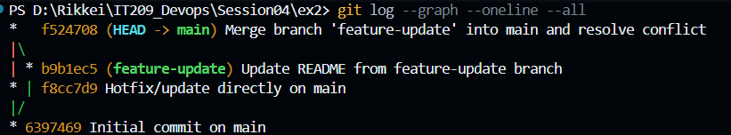

### Tóm tắt 
Xung đột xảy ra tại dòng 2 của README.md do cả main và feature-update cùng sửa trên một commit cha gốc nhưng nội dung khác nhau.

### Xử lý 
Mở tệp, xóa bỏ các marker <<<<<<< HEAD, =======, >>>>>>> feature-update, chỉnh sửa lại câu văn kết hợp cả 2 ý, lưu file rồi chạy git add README.md và git commit.